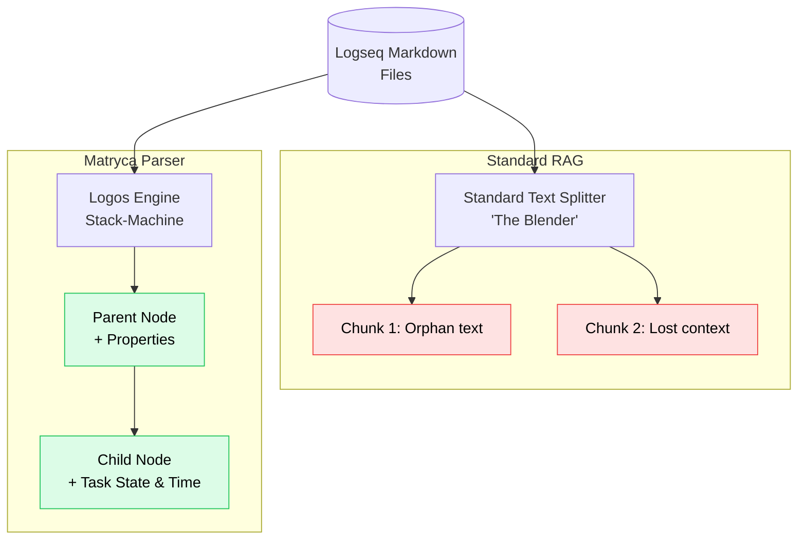

<div align="center">

# 🔱 Logseq Matryca Parser (The Logos Protocol)

**Stop feeding broken Markdown to your AI.**

[](https://github.com/MarcoPorcellato/logseq-matryca-parser/actions/workflows/ci.yml)
[](https://www.python.org/downloads/)
[](https://github.com/MarcoPorcellato/logseq-matryca-parser/blob/main/LICENSE)
[](https://pypi.org/project/logseq-matryca-parser/)
[](https://pypi.org/project/logseq-matryca-parser/)
[](#)


> *Turning a forest of local plain-text files into a unified semantic powerhouse.*

<p align="center">
  <video src="https://github.com/user-attachments/assets/24f73c6d-3eca-4adb-8442-981f2ba4cccd" autoplay loop muted playsinline width="800"></video>
</p>

[👉 **TRY THE LIVE INTERACTIVE DEMO**](https://MarcoPorcellato.github.io/logseq-matryca-parser/)

[Quickstart](#quickstart) · [Compatibility](#verified-logseq-markdown-compatibility) · [Documentation](docs/README.md) · [Roadmap](docs/ROADMAP_2026-2027.md) · [Cookbook](docs/COOKBOOK.md) · [Release highlights](RELEASE_HIGHLIGHTS.md) · [AI / LLM index](llms.txt)

</div>

---

## Quickstart

Install the package and scan a Logseq graph:

```bash
uv pip install logseq-matryca-parser
matryca-parse scan /path/to/logseq/graph
```

The scan reports pages, blocks, references, and graph diagnostics without
changing the vault. Continue with the [CLI and Python examples](#usage), or use
the [Cookbook](docs/COOKBOOK.md) for RAG, graph-query, watcher, and agent recipes.

Parsing and scanning are read-only. Source-vault writes are explicit, opt-in,
confined, and reviewable; exporters write derived artifacts to destinations
selected by the caller.

### Choose your workflow

- **Parse and query:** load one page or a complete vault as a typed AST and graph.
- **Build RAG context:** export LangChain documents and enriched chunks; use
  the separate LlamaIndex companion when available.
- **Move knowledge:** generate JSON, clean Markdown, or an Obsidian vault.
- **Visualize:** render an interactive reference-topology graph with the transitional,
  feature-frozen LENS adapter.
- **Use an AI agent:** start from [`AGENTS.md`](AGENTS.md) or the concise [`llms.txt`](llms.txt) index.

---

## Verified Logseq Markdown compatibility

**313/313 selected official Logseq Markdown documents passed our corpus checks.**

Testing against a pinned official documentation snapshot found no parser
exceptions, timeouts, or structural failures. Every input retained its exact
source text, and returned nodes passed identity and tree-linkage checks.

[Detailed compatibility report](docs/quality/OFFICIAL_LOGSEQ_MARKDOWN_COMPATIBILITY_2026-10-10.md) · [Per-document results](docs/quality/official_logseq_corpus_2026-10-10.json) · [Additional dataset study](docs/quality/LOGSEQ_MARKDOWN_DATASET_CANDIDATES_2026-10-10.md)

These results verify the tested corpus and checks—not complete interpretation
of every Logseq feature. Further datasets and semantic tests will extend this
evidence; they are not included in the current results.

---

## 🌐 The Vision: Virtual Centralization vs. Binary Lock-in

PKM (Personal Knowledge Management) tools differ in where knowledge lives,
how it is structured, and how other tools can use it. Local files and rich
structure are not mutually exclusive.

* **Logseq OG file graphs and Obsidian** keep Markdown notes locally but use
  different block, property and reference conventions. Obsidian also provides
  a note-link graph, structured properties, Search and Bases; it is not simply
  a folder without structure.
* **Tana Outliner** provides linked nodes, fields and supertags in a hosted
  workspace, with documented Markdown and JSON exports. Export availability
  and fidelity should be evaluated separately from the working storage model.
* **The new Logseq DB (SQLite)** uses a local database and provides official
  export paths. Its primary working state is not line-diffable Markdown,
  however, and the semantic fidelity of exported Markdown remains a separate
  interoperability question. Matryca does not currently claim to read or
  replace Logseq DB graphs.

### 🔱 The Matryca Solution: The Best of Both Worlds
**Logseq Matryca Parser** is the ultimate bridge. It allows you to **keep your sovereign, future-proof Markdown files**, while synthesizing a **Virtual Global Graph** in RAM at runtime.

It acts as the strict **File System Driver** for your LLM OS. A deterministic
Stack-Machine parses outliner topology and preserves each block's parent-child
context for LangChain and, through a separate optional companion, LlamaIndex.

The Parser's `[ai]` and `[all]` extras do not install LlamaIndex. The
`logseq-matryca-parser-llamaindex` companion is planned but not yet published
on PyPI; until then, `SynapseAdapter.to_llamaindex_nodes()` reports that the
companion is unavailable. The Parser lock and distributions no longer include
`llama-index-core` or NLTK. This removes that dependency chain from Parser; it
does not claim that the separate NLTK advisory is fixed for other consumers.

*You get the reasoning power of a centralized relational database, without sacrificing the plain-text soul of your Second Brain in Logseq.*

---

## ⚖️ The PKM Landscape

This compares workflows, not product rankings: Markdown is a format;
Obsidian, Logseq DB and Tana are applications; **Matryca Parser is a Python
library for Logseq Markdown**, not a replacement editor or sync service.

| Dimension | Vanilla Markdown | Obsidian | **Matryca Parser** | Logseq DB | Tana Outliner |
| :--- | :--- | :--- | :--- | :--- | :--- |
| **Working data** | Plain-text `.md` files | Local Markdown vault; optional cloud services | **Logseq Markdown source; derived in-memory AST/graph** | DB graph; local SQLite on desktop | Hosted workspace; documented exports |
| **Structure and links** | Headings, lists and link conventions | Note-link graph; headings/lists; optional `^block-id` anchors | **Typed block hierarchy, UUIDs, parent/left/path relations** | Linked nodes, properties and tags | Outline and node references |
| **Metadata and queries** | Depend on chosen tools | YAML properties; native Search and Bases | **Page/block properties, reference resolution, graph queries** | Typed properties and DB queries | Fields, supertags and search nodes |
| **Automation** | External scripts/tools | TypeScript plugins; CLI requires app; Headless services beta | **Python API and CLI without a note-taking app** | Official CLI and scripting | Product-specific commands and integrations |
| **History and control** | Git/backup configured separately | Local recovery; external Git; optional Sync history | Local source files; no built-in Git/sync or model-locality guarantee | Database backups and export snapshots | Hosted state and export snapshots |
| **Portability limits** | Syntax/rendering varies by tool | Extensions, Bases and Canvas need compatible tooling | Obsidian-compatible output; no lossless cross-app round trip promised | SQLite/EDN; Markdown export omits data | Markdown/JSON; Markdown ZIP excludes media |

[Full Obsidian comparison and official sources](docs/reference/PKM_OBSIDIAN_COMPARISON.md)
explain block identity, native versus community features, current CLI/Headless
scope and export limits. Obsidian-compatible export does **not** establish a
native Obsidian-vault input contract.

---

## 🧭 Matryca vs. naive framework loaders

| Capability | Typical LangChain / LlamaIndex Markdown loaders | **Matryca (LOGOS + SYNAPSE + graph)** |
| :--- | :--- | :--- |
| **Parent–child context** | Character or heading splits; children often orphaned from parents | **True outliner AST**: every block carries `parent_id`, `path`, `left_id` and visits in deterministic tree order |
| **Block references `((uuid))`** | Treated as opaque text or dropped | **Resolved** against `LogseqGraph`; optional **embed expansion** and **Obsidian `[[Page#^anchor]]`** export |
| **Property inheritance** | Page-level frontmatter at best | **`get_effective_properties`**: page + ancestor outline keys merged top-down (Org-mode style), then exposed on enriched chunks |
| **Live sync** | Re-read whole tree or poll | **`LogseqGraph.start_watching()`** (optional `watchdog`): **per-file invalidation** — re-parse one page, purge stale UUIDs from registries, refresh backlinks |
| **Page aliases & titles** | Filename-only or manual link maps | **`title::`**, **`alias::`** / **`aliases::`** re-key `graph.pages` and wire **backlinks** for alias wikilinks |
| **Case-insensitive pages & tags** | Exact string match on filenames | **`get_page`**, **`resolve_relative_page_link`**, **`search_content`**, and **`GraphQuery.has_tag`** use case-insensitive matching (Datomic / Logseq parity) |
| **Attachments & assets** | Opaque `` text in chunks | **`LogseqNode.assets`** + **`LogseqPage.resolve_asset_path`** for graph-root PDFs and images |

---

### 🚀 The Problem
Standard RAG pipelines treat your notes like a blender. They chop Markdown into random shards, destroying the **parent-child hierarchy** that makes Logseq powerful.



### 🔱 The Solution
Logseq Matryca Parser is a deterministic **Stack-Machine engine** that acts as the **File System Driver** for your LLM. It preserves the true topology of your thoughts, ensuring AI understands spatial hierarchy, time, and block-lineage—including **structured task state** and **first-class temporal attributes** you can query in downstream graph databases and GraphRAG engines without re-parsing raw Markdown.

---

## 🏗️ Core capabilities

| Outcome | What Matryca provides |
| :--- | :--- |
| **Parse faithfully — LOGOS** | Deterministic AST parsing for outlines, YAML and native properties, tasks, temporal markers, references, assets, code/math/query shields, stable UUIDs, line ranges, and format-preserving round trips. |
| **Understand the vault — Graph** | Canonical pages, aliases, backlinks, inherited properties, case-insensitive lookup, namespace resolution, fluent queries, broken-reference diagnostics, and optional per-file live reloads. |
| **Export and integrate — SYNAPSE, FORGE, LENS** | Lineage-aware LangChain exports and context-enriched chunks; LlamaIndex nodes through a separate companion; JSON and Markdown serialization, Obsidian vault generation, and interactive graph visualization. |
| **Automate safely — KINETIC and agent tools** | CLI parse, scan, export, and visualization; token-efficient X-Ray reads; append-only logging; bounded AST writes; vault containment, dry-run patches, and atomic replacement. |

`agent-read` also writes `.matryca_xray_state.json` under the selected graph
path. Until its state-write boundary is corrected, use X-Ray only with trusted
vaults; this state write is not covered by the Markdown writer's guarantees.

The v1.11.0 release line also contains an **experimental, read-only Org
reader** behind a private, non-stable API. It reads Org text or one selected
`.org` file; it does not load a vault graph or claim complete GNU Org or
Logseq semantics. Its diagnostics are selective, not a complete inventory of
unsupported syntax. See the [API stability contract](docs/reference/API_STABILITY.md)
and [release highlights](RELEASE_HIGHLIGHTS.md).

The base parser is local-first and has zero telemetry. Optional AI, watcher, and
visualization dependencies remain lazy. See the [architecture](docs/ARCHITECTURE.md)
and [API stability reference](docs/reference/API_STABILITY.md) for exact boundaries.
For cross-product Logseq OG use, Plumber is the gateway to Trama and Brain;
Parser remains the deterministic parsing stage. LENS stays compatible while a
future Trama graph-intelligence migration is separately designed and released.
Stage 0 marks LENS as transitional and feature-frozen: `GraphVisualizer`,
`matryca-parse visualize`, and `matryca-parse demo` remain available without a
deprecation warning. Matryca Trama is the destination for future user-facing
graph intelligence.

### Data model — `LogseqNode` task fields

Each AST block is a `LogseqNode`. Alongside `task_status`, the parser surfaces priority and schedule metadata as typed fields (epoch integers are **seconds since Unix epoch, UTC**):

```json
{
  "uuid": "6ba7b810-9dad-11d1-80b4-00c04fd430c8",
  "task_status": "TODO",
  "task_priority": "A",
  "scheduled_at": 1641600000,
  "deadline_at": 1641772800,
  "clean_text": "Cut v0.3.2 release"
}
```

Marker syntax (`[#A]`, `SCHEDULED: <...>`, `DEADLINE: <...>`) is stripped from `clean_text` so embeddings stay clean; the promoted fields carry the structured signal for downstream graph databases and GraphRAG engines.

---

## Usage

```bash
# Optional: filesystem watcher for live incremental graph updates
uv pip install 'logseq-matryca-parser[watch]'

# Or clone and sync all extras locally
uv sync --all-extras
```

```bash
# 1. Visualize your local graph (LENS: transitional, feature-frozen)
matryca-parse visualize /path/to/logseq/graph my-map.html

# 2. Export for AI / RAG (SYNAPSE)
matryca-parse export /path/to/logseq/graph output --format langchain

# 3. Context-enriched LangChain JSON (graph + inheritance + embed expansion)
matryca-parse export /path/to/logseq/graph output --format langchain-enriched

# 4. Obsidian vault (YAML frontmatter + ^ block ids)
matryca-parse export /path/to/logseq/graph output --format obsidian

# Global options (all subcommands): --verbose, --graph /path/to/vault
matryca-parse --graph /path/to/logseq/graph --verbose export output --format json
```

### Python API

Prefer the package root for stable imports (see **`__all__`** in **`logseq_matryca_parser`**):

```python
from logseq_matryca_parser import (
    LogseqGraph,
    LogosParser,
    SynapseAdapter,
    SessionAliasRegistry,
    discover_graph_files,
)

# Parse a single page to AST (YAML or native frontmatter; utf-8-sig BOM-safe)
page = LogosParser().parse_page_file("page.md")
if page.root_nodes[0].assets:
    absolute = page.resolve_asset_path(page.root_nodes[0].assets[0])

# Load the whole vault (pages, backlinks, node registry)
graph = LogseqGraph.load_directory("/path/to/logseq/graph")
page_obj = graph.get_page("My Page")  # case-insensitive
effective = graph.get_effective_properties(page_obj.root_nodes[0].uuid)

# Build in-memory indexes from captured Markdown; some reads resolve host paths.
from logseq_matryca_parser import SnapshotPage

snapshot_graph = LogseqGraph.from_snapshot_pages(
    "/path/to/logseq/graph",
    [SnapshotPage("pages/Project.md", "- Captured block\n")],
)

# Export to LangChain with lineage metadata
docs = SynapseAdapter.to_langchain_documents(page.root_nodes, source_name=page.title)

# Optional strict same-page block-ref validation at parse time
from logseq_matryca_parser import StackMachineParser

strict_page = StackMachineParser(strict_refs=True).parse_page_file("page.md")
```

`uv sync --extra ai` installs LangChain. `[all]` also installs the visualization
dependencies. Neither extra installs LlamaIndex or NLTK. LlamaIndex export
remains available through the `SynapseAdapter` compatibility method when the
separate `logseq-matryca-parser-llamaindex` companion is installed. That
companion is planned but not yet published on PyPI; see the
[support matrix](docs/reference/CONFORMANCE_SUPPORT_MATRIX.md) for the current
boundary. The Parser itself does not install `llama-index-core` or NLTK.

### 🤖 Agentic Write Access (Append-Only)

Agents such as Hermes or OpenClaw can record structured notes into a Logseq graph **without rewriting existing pages**. The helper `logseq_agent_write` only **opens the weekly agent page in append mode** (`"a"`), writes a new bullet (journal link + optional tag links + body), and never truncates or replaces prior content—so routine logging cannot wipe blocks that already live in that file.

Point it at your graph’s **`pages`** directory and **`config.edn`** so journal titles match Logseq’s `:journal/page-title-format` (including ordinal days when you use `do` in the pattern).

```python
from logseq_matryca_parser import logseq_agent_write

result = logseq_agent_write(
    "Summarized user intent and proposed next steps.",
    config_path="/path/to/logseq/config.edn",
    pages_dir="/path/to/logseq/pages",
    context_tags=["agent/hermes", "#session"],
)
assert result["status"] == "success"
# result["path"] → e.g. .../pages/2026-18-agent.md
```
---

## 🗺️ Roadmap
- [ ] **Graph-intelligence UI:** A future Matryca Trama surface may succeed the
  compatible Parser LENS workflow after a separately reviewed migration; Parser
  does not commit to a standalone GUI. [(Track the historical RFC)](https://github.com/MarcoPorcellato/logseq-matryca-parser/issues/3)
- [x] **Obsidian Adapter:** Native CLI export (`--format obsidian`) with YAML frontmatter and `^` block anchors.
- [ ] **Ollama Integration:** One-click local RAG setup. [(RFC draft)](docs/rfc/OLLAMA_RAG.md) · [(Track progress #34)](https://github.com/MarcoPorcellato/logseq-matryca-parser/issues/34)

## ☕ Support & Enterprise
Logseq Matryca Parser is open-source. If it powers your pipeline, consider a star ⭐ or a sponsorship!

**💖 [Sponsor me on GitHub](https://github.com/sponsors/MarcoPorcellato)**

Need custom RAG integrations or consulting? Contact: [marco@marcoporcellato.it](mailto:marco@marcoporcellato.it)

## 🤝 Contributing & Community

We welcome issues, pull requests, and constructive feedback.

| Resource | Link |
| :--- | :--- |
| **Good first issues** | [Recommended starter pack](docs/GOOD_FIRST_ISSUES.md#recommended-starter-pack) — dated Wave 5/6 selection and preserved earlier IDs; recheck GitHub before claiming |
| **Contributing** | [CONTRIBUTING.md](CONTRIBUTING.md) — setup, tests, PR workflow |
| **Cookbook** | [docs/COOKBOOK.md](docs/COOKBOOK.md) — integration recipes (Synapse, graph query, watcher) |
| **Documentation index** | [docs/README.md](docs/README.md) — active vs historical docs |
| **Documentation system** | [docs/DOCUMENTATION_SYSTEM.md](docs/DOCUMENTATION_SYSTEM.md) — authority, lifecycle, metadata, and federation |
| **Roadmap** | [docs/ROADMAP_2026-2027.md](docs/ROADMAP_2026-2027.md) — milestones, dependencies, and evidence gates |
| **Markdown compatibility evidence** | [Official Logseq corpus report](docs/quality/OFFICIAL_LOGSEQ_MARKDOWN_COMPATIBILITY_2026-10-10.md) — all 313 selected official documents passed raw-content and tree checks; semantic coverage and limits are explained |
| **Generated assurance and acceptance** | [Current delivery](docs/quality/COMPOSITE_MARKDOWN_ASSURANCE_2026-10-03.md#current-delivery-and-release-status) and [#104 acceptance package](docs/quality/PARSER_ASSURANCE_ACCEPTANCE_2026-10-18.md) — bounded checks, selected depth coverage and explicit acceptance gates |
| **Support** | [SUPPORT.md](SUPPORT.md) — safe issue routing, support scope, and response boundaries |
| **Governance** | [GOVERNANCE.md](GOVERNANCE.md) — decisions, maintainer path, and conflict handling |
| **Agent safety** | [docs/reference/AGENT_ACTION_CONTRACT.md](docs/reference/AGENT_ACTION_CONTRACT.md) — authority, approvals, provenance, and prompt-injection boundary |
| **Code of Conduct** | [CODE_OF_CONDUCT.md](CODE_OF_CONDUCT.md) — community standards |
| **Security** | [SECURITY.md](SECURITY.md) — report vulnerabilities privately |

## 📦 Release history

Current source version: **v1.11.2**. The [PyPI project page](https://pypi.org/project/logseq-matryca-parser/) and
[GitHub Releases](https://github.com/MarcoPorcellato/logseq-matryca-parser/releases) list available distributions.
Security support follows the [latest-release policy](SECURITY.md).

The v1.11.2 source removes repeated page scans from attached-node graph reads
while preserving aliases, collision filtering and node order. It also adds a
focused refresh-depth test matrix and consolidates assurance documentation.
This does not establish end-to-end Plumber dashboard performance or cancellation.
See the [changelog](CHANGELOG.md) for scope, limits and known issues.

Read the complete [release highlights](RELEASE_HIGHLIGHTS.md), the exhaustive
[changelog](CHANGELOG.md), or the signed artifacts on
[GitHub Releases](https://github.com/MarcoPorcellato/logseq-matryca-parser/releases).

- **v1.11.2** — Bounds graph ownership-resolution work per read, extends focused refresh-depth tests, and consolidates assurance and PKM comparison documentation.
- **v1.11.1** — Fixes fenced-code parsing in outline items, preserves eligible multiline scalar-metadata round trips, and adds bounded composite Markdown assurance.
- **v1.11.0** — Adds an experimental, read-only Logseq Org reader with source retention and explicit support limits.
- **v1.10.0** — Clarifies the LlamaIndex companion boundary and removes the Parser's NLTK dependency chain.
- **v1.9.0** — Adds the stable in-memory snapshot graph factory, clarifies the Parser-Plumber boundary, and governs the temporary optional-NLTK advisory exception.
- **v1.8.2** — Adds SHA-pinned hosted assurance, portable Windows local assurance, corrected cookbook recipes, consistent optional-AI guidance, and `Path | str` graph loading.
- **v1.8.1** — Hardened deep-outline parsing, coherent incremental graph mutations, bounded assurance cleanup, and stable provenance for optional NLTK.
- **v1.8.0** — Added bounded privacy-safe local graph assurance, source-location contracts, and the first internal parser line-classification phase.
- **v1.7.1** — Added the runnable offline SYNAPSE RAG example and tightened release-note and optional-dependency security checks.
- **v1.7.0** — Hardened parser correctness, graph diagnostics, writer safety, API stability, documentation governance, and release provenance.
- **v1.6.0** — Clean Architecture v1 structural slices, new public graph APIs, layer-boundary CI, and documentation SSOT.
- **v1.5.0 (documented version)** — Added opt-in CLI detection of unresolved block references; no release artifacts are currently listed (see highlights).
- **v1.4.2** — Fixed agent-write newline handling, controlled corrupt-state failures, and cyclic SYNAPSE page embeds.
- **v1.4.1** — Expanded contributor tests and refreshed the good-first-issue onboarding path.
- **v1.4.0** — Strengthened graph integrity, live reloads, serialization, path safety, strict references, and parser edge cases.
- **v1.3.1** — Aligned examples and skill installation instructions with the repository's `uv` workflow.
- **v1.3.0** — Expanded the stable API and improved graph reloads, strict references, SYNAPSE metadata, CLI behavior, and optional imports.
- **v1.2.2** — Restored CodeQL workflow reliability and documented its supported configuration.
- **v1.2.1** — Added the Python 3.12/3.13 CI matrix, security gates, release pre-flight, and contributor infrastructure.
- **v1.2.0** — Added graph parity, assets, round-trip serialization, Obsidian export, live watching, agent X-Ray mode, and headless writes.
- **v1.1.1** — Established title and alias indexing, backlinks, incremental reload, parser shields, property parsing, and broader task markers.

---
Architected by **Marco Porcellato** | Powered by **Matryca.ai**
